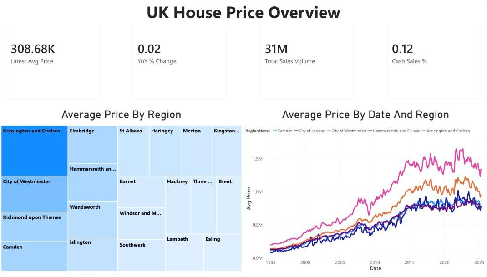
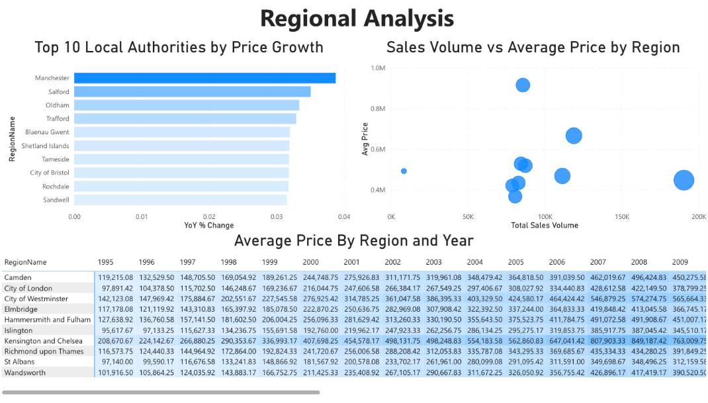
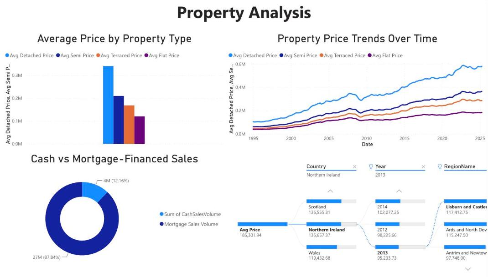
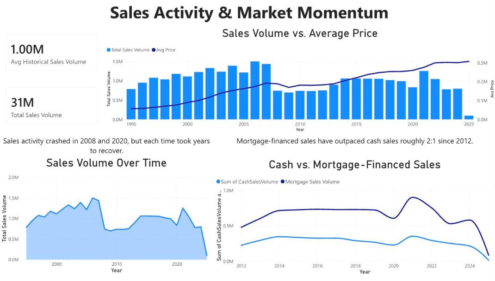
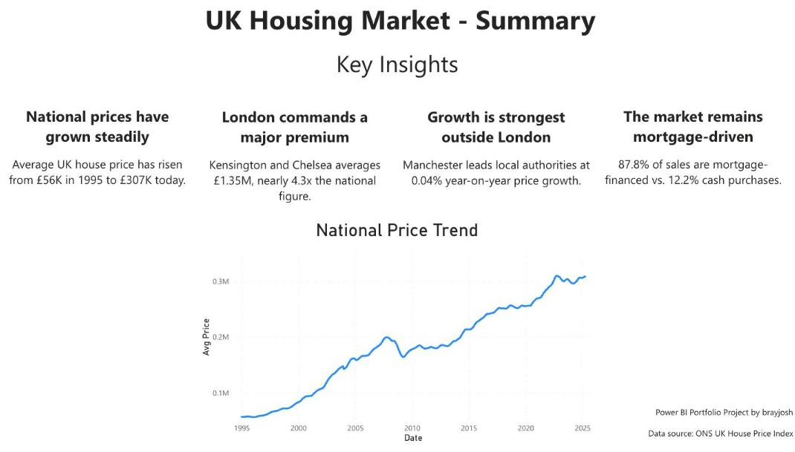

# UK House Prices Report

An interactive Power BI report exploring UK house prices from 1995 to 2025: national and regional trends, property types, sales volumes and how purchases are financed.

## Report pages

| Page | What it shows |
| --- | --- |
| **UK House Price Overview** | Headline KPIs (latest average price, year-on-year change, total sales volume, cash sales %), average price by region and price trends for selected regions |
| **Regional Analysis** | Top 10 local authorities by price growth, sales volume vs average price by region, and average price by region and year |
| **Property Analysis** | Average prices by property type (detached, semi-detached, terraced, flat), price trends over time, cash vs mortgage-financed sales and a decomposition tree by country, year and region |
| **Sales Activity & Market Momentum** | Sales volume vs average price, sales volume over time and cash vs mortgage-financed sales since 2012 |
| **UK Housing Market - Summary** | Key insights and the national price trend |

## Screenshots

### Regional Analysis

### Property Analysis

### Sales Activity & Market Momentum

### UK Housing Market - Summary

## Repository contents

| Path | Description |
| --- | --- |
| `UK-House-Price.pbix` | The report, semantic model and imported data in a single Power BI file |
| `assets/` | Screenshots of each report page |

## Import the report into a new environment

The `.pbix` includes the data, so the report works as soon as it's imported. No data source credentials are needed.

### Power BI service (any OS, including Mac)

1. Download `UK-House-Price.pbix` from this repository.
2. Go to [app.powerbi.com](https://app.powerbi.com) and open the workspace you want to use (for example, **My workspace**).
3. Select **Upload** > **Browse**, then choose `UK-House-Price.pbix`.
4. Open the **UK House Price** report from the workspace.

### Power BI Desktop (Windows)

1. Download `UK-House-Price.pbix` from this repository.
2. Open it in Power BI Desktop to view or edit the report.
3. To publish, select **Home** > **Publish** and choose a workspace.

## Prerequisites

- A Power BI account. Uploading to **My workspace** works with a free licence. Sharing the report with others needs Power BI Pro, Premium Per User or a workspace on Fabric capacity.
- Power BI Desktop (Windows) only if you want to edit the report.

## Data source

[UK House Price Index](https://www.gov.uk/government/collections/uk-house-price-index-reports) (HM Land Registry and the Office for National Statistics), used under the [Open Government Licence v3.0](https://www.nationalarchives.gov.uk/doc/open-government-licence/version/3/).

## Author

Josh Bray ([@brayjosh](https://github.com/brayjosh))

## Licence

This project is licensed under the [MIT Licence](LICENSE). The UK House Price Index data remains subject to the Open Government Licence v3.0.
